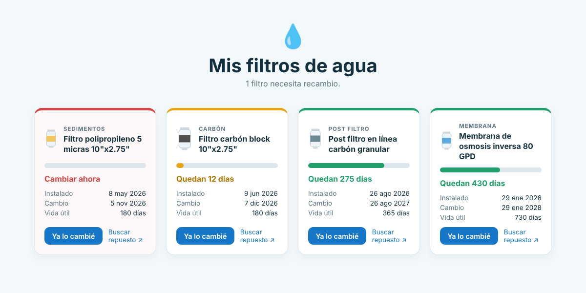

# 💧 Filter Project — Frontend

A small dashboard to keep track of when each cartridge of a home water filter system needs to be replaced.
It shows the days left for every stage, highlights the ones that are due, and lets you start a new cycle with one click.



Backend (REST API + SQLite): **[filter-project-backend](https://github.com/patcont/filter-project-backend)**

## Features

- One card per filter stage (sediment, carbon block, post filter, RO membrane)
- Progress bar and color status: ok / due soon (≤ 15 % left) / replace now
- Install date, due date and lifespan for each filter
- "Ya lo cambié" starts a new cycle (native `<dialog>` confirmation)
- Friendly error state when the API is not running

## Tech

React 19 · Vite · Vitest · plain CSS (no UI framework)

## Run it locally

Start the [backend](https://github.com/patcont/filter-project-backend) first, then:

```bash
cp .env.example .env   # set VITE_API_URL if the API is not on localhost:5000
npm install
npm run dev            # http://localhost:5173
npm test
npm run build
```

## 2026 rebuild

- Create React App → Vite; React Bootstrap, `moment`, `react-moment` and `date-fns` removed
- Fixed an infinite fetch loop (the effect depended on the state it was updating)
- Lifespans are no longer hard-coded to "1 minute test mode": they come from the API and are real days
- API URL configurable through `VITE_API_URL`
- Stock product photos replaced with small SVG illustrations

The original version is preserved in the git history.
